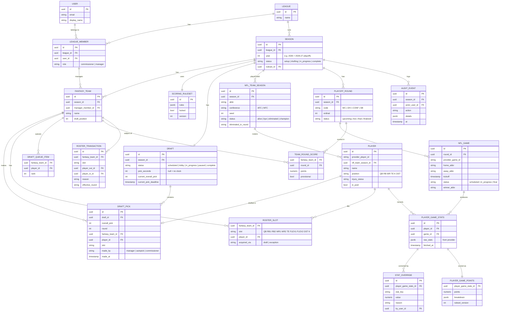

# 02 — Domain Model

> **Storage note (2026-11-09):** the database is DynamoDB. The entities, relationships and invariants below still define *what* is stored and guaranteed; [10-dynamodb-data-model](10-dynamodb-data-model.md) defines *how* (keys, transactions, conditional writes). Column types like `uuid`/`jsonb` are conceptual. `ROSTER_SLOT` is stored as per-round history entries (10 §2).

## 1. Entity-relationship diagram

## 2. Entity notes

- **League → Season.** The league persists across years; each year's playoffs is a new `SEASON` with its own teams, draft, rules and player pool. Last year's season stays readable.
- **Player is per-season.** A player row is created when the playoff field is imported. `provider_player_id` links back to the stats API for ingestion.
- **DST is a "player".** Each playoff team gets one `PLAYER` with position `DST`, so the draft and scoring treat it uniformly.
- **Roster slots are explicit.** Even though there are no lineup decisions, storing the slot (RB1 vs FLEX2) keeps the roster display stable and makes exceptions ("replace FLEX1") unambiguous.
- **Raw stats vs. overrides vs. points.** Provider data is stored untouched in `PLAYER_GAME_STATS.raw_stats`. Commissioner corrections live in `STAT_OVERRIDE`. Points are always derived: `points = score(rules, raw_stats ⊕ overrides)`. Re-ingesting never wipes an override.
- **Team round scores are a cache.** `TEAM_ROUND_SCORE` can be rebuilt from player points at any time; it exists for fast standings.

## 3. Invariants (enforce in the database where possible)

| # | Invariant | Enforcement |
|---|-----------|-------------|
| I-1 | A player is drafted at most once per draft | Unique `(draft_id, player_id)` on `DRAFT_PICK` |
| I-2 | Each overall pick number used once | Unique `(draft_id, overall_pick)` |
| I-3 | Each team has at most one player per slot | Unique `(fantasy_team_id, slot)` on `ROSTER_SLOT` |
| I-4 | A player fills an eligible slot only | Server-side validation (+ check constraint via eligibility table) |
| I-5 | Only the team on the clock can pick (except commissioner/autopick) | Server-side, inside the pick transaction |
| I-6 | Ruleset is locked before draft starts; finalized rounds are immutable | Status checks on write |
| I-7 | Exactly 9 teams, 10 slots each, 90 picks | Season setup validation; draft completes at pick 90 |

## 4. Playoff structure reference

| Round | Code | Games | Teams playing | Notes |
|-------|------|-------|---------------|-------|
| Wild Card | WC | 6 | 12 | #1 seeds (1 AFC, 1 NFC) on bye |
| Divisional | DIV | 4 | 8 | |
| Conference Championships | CONF | 2 | 4 | |
| Super Bowl | SB | 1 | 2 | Usually 2 weeks after CONF |

A player can play at most 4 games (a non-#1 seed reaching the Super Bowl) or 3 games (a #1 seed). This matters for draft strategy, and the UI should surface it (seed + "max games remaining").
