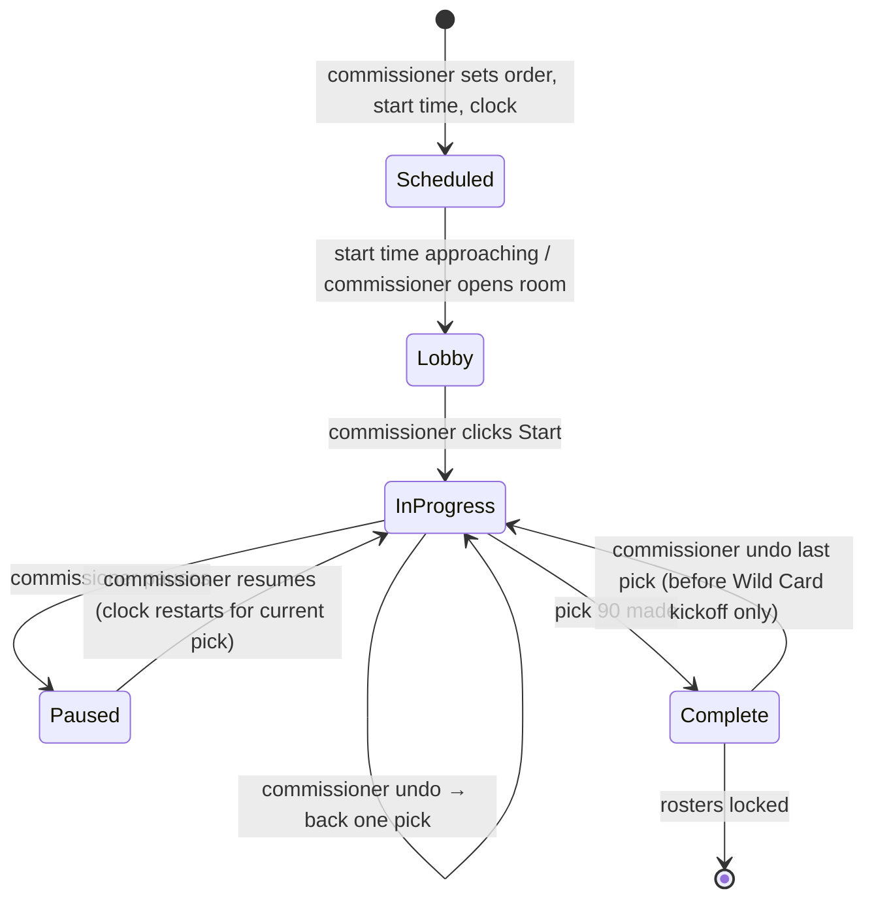
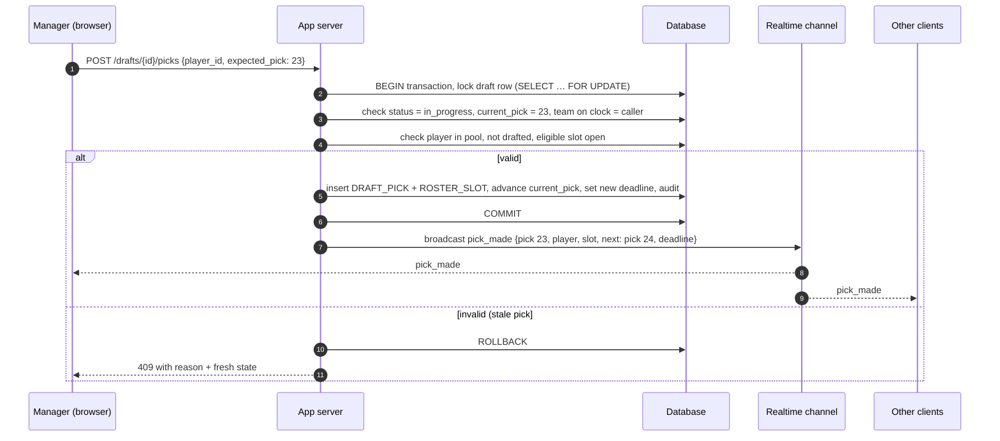

# 03 — Draft Design

## 1. Format

- **Live snake draft**, 9 teams × 10 rounds = **90 picks**.
- Odd rounds go 1→9, even rounds go 9→1.
- Every pick must land in an open, eligible roster slot. When the draft ends, every team has a full, locked 10-player lineup.

### Pick order formula

```
round        = ceil(overall_pick / 9)
index_in_rnd = (overall_pick - 1) mod 9            // 0..8
draft_pos    = round is odd ? index_in_rnd + 1 : 9 - index_in_rnd
```

| Round | Order |
|-------|-------|
| 1 | 1 2 3 4 5 6 7 8 9 |
| 2 | 9 8 7 6 5 4 3 2 1 |
| 3 | 1 2 3 4 5 6 7 8 9 |
| … | … |
| 10 | 9 8 7 6 5 4 3 2 1 |

## 2. Draft lifecycle



**Preconditions to Start:** 9 teams with managers, draft order set, scoring ruleset locked, player pool imported.

## 3. Slot eligibility & auto-assignment

When a player is drafted, the server assigns them to the **most specific** open slot so FLEX stays available as long as possible:

```
QB  → QB
RB  → RB1, RB2, then FLEX1, FLEX2
WR  → WR1, WR2, then FLEX1, FLEX2
TE  → TE,       then FLEX1, FLEX2
K   → K
DST → DST
```

A player is **draftable by a team** only if the table above yields an open slot for that team. The available-players list greys out ineligible players for the manager on the clock (e.g. a second QB, or a 5th RB/WR/TE once both FLEX are filled).

### Avoiding dead ends
Because every slot must be filled, the server also checks that after the pick the team can still fill its remaining slots (always true with this roster since the pool is large — but it's a cheap guard and prevents odd endings if the pool is ever trimmed).

## 4. Making a pick



**Key rules**
- The server is the single source of truth. Clients never advance the draft themselves.
- `expected_pick` makes the request idempotent and rejects double-clicks or stale tabs.
- The DB uniqueness constraints (see 02, I-1/I-2) are the last line of defence against races.

## 5. Pick clock & autopick

- Configurable per draft: off, or N seconds per pick (default 90s, see Q6).
- The **deadline** is stored server-side (`current_pick_deadline`); clients only display a countdown from it.
- A server-side job checks for expired deadlines every few seconds. On expiry:
  1. Take the highest-ranked **queued** player who is still available and eligible.
  2. Otherwise, take the best available eligible player by the default ranking (provider projection/ADP, else a simple positional ranking).
  3. Record `made_by = autopick`.
- If the clock is off, the draft waits indefinitely; the commissioner can pick on a manager's behalf.
- Pause stops the clock; resume gives the current pick a fresh full clock.

## 6. Manager queue

- Each manager can rank players into a private queue before and during the draft.
- Drafted players disappear from all queues automatically.
- Optional "auto-draft from queue" toggle: when on, the manager's pick is made immediately from the queue when they come on the clock (useful if someone has to step away).

## 7. Commissioner controls

| Action | When | Effect |
|--------|------|--------|
| Set / randomize order | Scheduled, Lobby | Assigns `draft_position` 1–9 |
| Start | Lobby | Pick 1 on the clock |
| Pause / Resume | InProgress | Freezes / restarts clock |
| Undo last pick | InProgress, Complete (before WC kickoff) | Deletes last pick + slot, previous team back on clock, audit logged |
| Pick for team | InProgress | Makes the current pick, `made_by = commissioner` |
| Edit player pool | Scheduled, Lobby, Paused | Add/remove players (cannot remove a drafted player) |

Every action broadcasts to all clients and is written to the audit log.

## 8. Realtime events

| Event | Payload |
|-------|---------|
| `draft_state` | Full snapshot (sent on join/reconnect) |
| `pick_made` | pick #, team, player, slot, next pick #, deadline |
| `pick_undone` | pick #, restored pick #, deadline |
| `status_changed` | new status (paused, resumed, complete) |
| `presence` | which managers are connected (nice to have) |

### Reconnect strategy
On load or reconnect, the client (1) fetches the full snapshot over HTTP, then (2) subscribes to the channel and applies events with `overall_pick` greater than the snapshot's. If an event arrives out of sequence, the client refetches the snapshot. This makes refreshes, phone sleep and flaky Wi-Fi safe.

## 9. Edge cases

| Case | Handling |
|------|----------|
| Two tabs from same manager | Both get updates; only the first valid pick wins (409 for the other) |
| Manager never shows up | Clock + autopick, or commissioner picks |
| Player gets hurt mid-draft | Commissioner can remove an undrafted player from the pool while paused |
| Server restart mid-draft | State is in the DB; deadline is persisted; clients reconnect and refetch |
| Wrong pick by mistake | Manager asks commissioner to undo (only the last pick can be undone) |
| Draft not finished before WC kickoff | Commissioner warning in lobby; app blocks starting scoring until draft complete |
