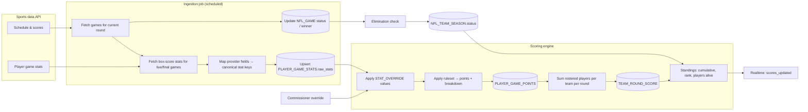
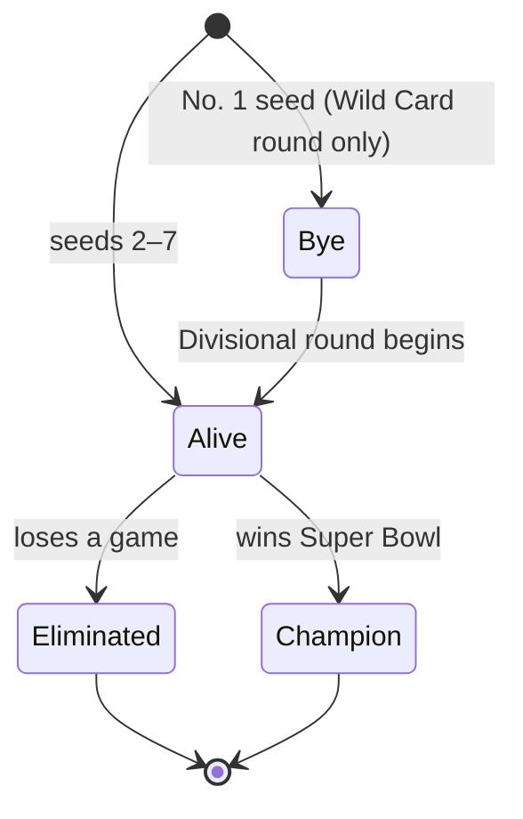
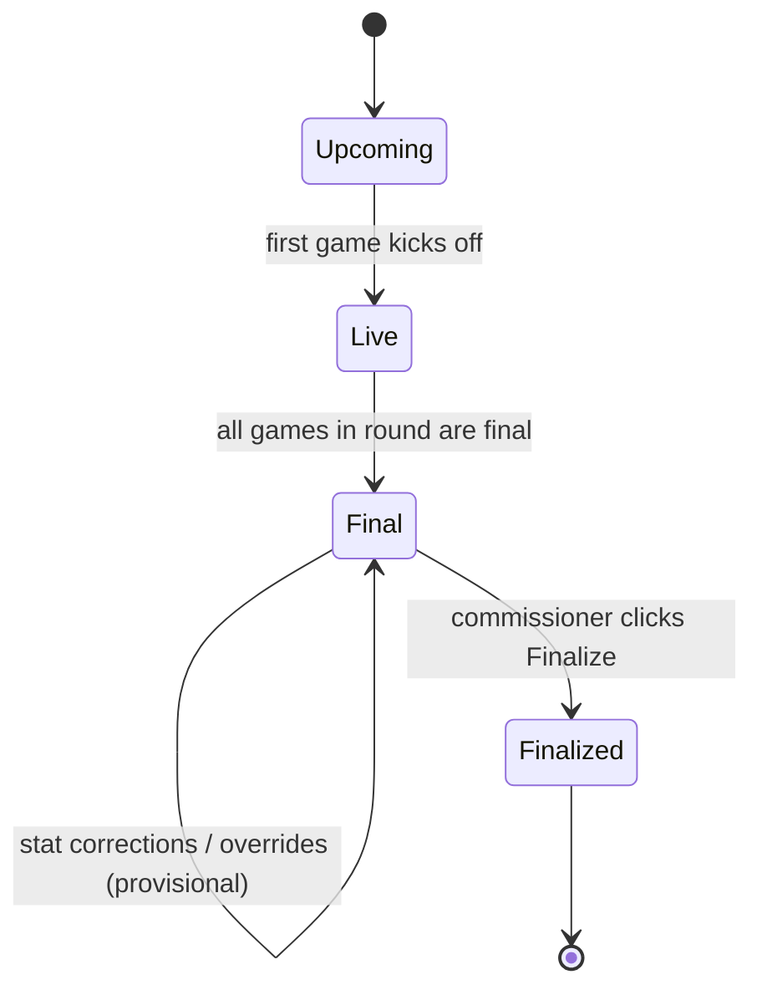

# 04 — Scoring Design

## 1. Principles

1. **Rules are data, not code.** The league's custom scoring lives in a versioned JSON ruleset. Changing a value never needs a deploy.
2. **Derived, never edited.** Points are always computed from `raw provider stats ⊕ commissioner overrides` using the ruleset. Nothing is hand-typed into a points column.
3. **Recompute anytime.** Any change (new stats, override, rules fix) triggers a recompute of the affected player-games and teams. Same inputs → same outputs.
4. **Provisional vs. final.** Live game scores are shown as provisional; the commissioner finalizes each round to freeze it.

## 2. Scoring ruleset (configurable)

The actual values come from the league (see Q1). The engine supports these rule types so the custom rules can be expressed without code:

| Rule type | Example | Shape |
|-----------|---------|-------|
| **Per unit** | 1 pt per 10 rushing yards | `{stat, points, per}` |
| **Per event** | 6 pts per rushing TD, −2 per interception | `{stat, points}` |
| **Threshold bonus** | +3 for 100+ rushing yards in a game | `{stat, gte, points}` |
| **Tiered (bands)** | DST points allowed: 0 → +10, 1–6 → +7 … | `{stat, tiers:[{min,max,points}]}` |
| **Distance bands** | FG 0–39 → 3, 40–49 → 4, 50+ → 5 | tiered on each event's distance |
| **Position scope** | TE-premium reception points | any rule may add `positions:[…]` |

Example skeleton (placeholder values — **not** the league's rules):

```json
{
  "version": 1,
  "rounding": 2,
  "rules": [
    { "stat": "pass_yds",  "points": 1, "per": 25 },
    { "stat": "pass_td",   "points": 4 },
    { "stat": "pass_int",  "points": -2 },
    { "stat": "rush_yds",  "points": 1, "per": 10 },
    { "stat": "rush_td",   "points": 6 },
    { "stat": "rec",       "points": 0 },
    { "stat": "rec_yds",   "points": 1, "per": 10 },
    { "stat": "rec_td",    "points": 6 },
    { "stat": "fum_lost",  "points": -2 },
    { "stat": "two_pt",    "points": 2 },
    { "stat": "rush_yds",  "gte": 100, "points": 3, "type": "bonus" },
    { "stat": "fg_made",   "type": "distance_tiers",
      "tiers": [ {"min":0,"max":39,"points":3}, {"min":40,"max":49,"points":4}, {"min":50,"points":5} ] },
    { "stat": "xp_made",   "points": 1, "positions": ["K"] },
    { "stat": "def_pts_allowed", "type": "tiers", "positions": ["DST"],
      "tiers": [ {"min":0,"max":0,"points":10}, {"min":1,"max":6,"points":7}, {"min":7,"max":13,"points":4},
                 {"min":14,"max":20,"points":1}, {"min":21,"max":27,"points":0}, {"min":28,"points":-4} ] },
    { "stat": "def_sack",  "points": 1, "positions": ["DST"] },
    { "stat": "def_int",   "points": 2, "positions": ["DST"] },
    { "stat": "def_td",    "points": 6, "positions": ["DST"] }
  ]
}
```

**Canonical stat keys.** The app defines its own stat vocabulary (`pass_yds`, `rush_td`, `def_sack`, …). Each stats provider adapter maps the provider's fields to these keys, so the ruleset never depends on a specific provider.

**Lifecycle:** draft the ruleset → commissioner reviews with a "preview against last year's playoffs" tool → **lock** before the draft. A locked ruleset can only change through a new version, which triggers a full recompute and an audit entry.

## 3. Stats pipeline



### Ingestion schedule
| Situation | Frequency |
|-----------|-----------|
| A playoff game is in progress | every 1–2 minutes |
| Game day, no game live | every 15 minutes |
| Between rounds (stat-correction period) | every 6 hours |
| Season complete | off |

Jobs are idempotent: re-running with the same provider data changes nothing.

### Provider adapter interface
```
interface StatsProvider {
  getPlayoffField(seasonYear)  → teams, seeds, conferences
  getPlayers(teamIds)          → players with positions, injury status
  getGames(round)              → schedule, status, scores, winners
  getPlayerGameStats(gameId)   → per-player stat lines (provider fields)
  mapToCanonical(statLine)     → { canonical_key: value }
}
```
A **manual/CSV adapter** implements the same interface as a fallback if the API fails during a game.

## 4. Elimination & player status

When a game goes final, the loser's `NFL_TEAM_SEASON.status` becomes `eliminated` (with the round), the winner stays `alive`, and the Super Bowl winner becomes `champion`.



Each rostered player inherits their NFL team's status. The UI shows per fantasy team:
- **Players alive** (e.g. "6/10 alive")
- **Max games remaining** — sum over alive players of rounds left their team could play. A useful "upside" indicator, especially since #1-seed players play at most 3 games.

## 5. Team scores & standings

```
player_round_points(p, r) = Σ points of p's games in round r   (0 if bye/eliminated)
team_round_points(t, r)   = Σ player_round_points over t's 10 roster slots for round r
team_total(t)             = Σ team_round_points over all rounds
```

- With roster exceptions, a slot may hold different players in different rounds; the transaction's `effective_round` decides which player counts in which round.
- Standings sort by `team_total` desc. Ties → tiebreaker rules (Q4); until decided, tied teams share the rank and the commissioner is alerted.
- Final placings (1st/2nd/3rd) are shown once the Super Bowl round is finalized.

## 6. Round finalization



- **Live/Final**: scores update automatically and are marked provisional.
- **Finalized**: the round's points are frozen. Ingestion keeps raw stats, but late changes no longer move frozen points (the commissioner sees a "provider changed after finalization" warning and can choose to unfreeze — audited).

## 7. Commissioner overrides

- Edit any canonical stat for a player-game (e.g. "rush_td: 1 → 2, reason: stat correction").
- Overrides are stored separately and re-applied after every ingestion, so the provider can't overwrite them.
- The player page shows overridden stats with a marker and the reason.
- Everything is in the audit log.

## 8. Testing strategy for scoring

- **Unit tests** per rule type with hand-computed expectations.
- **Golden test:** run the engine against last season's (2025–26) playoffs with the final ruleset and compare a handful of players against hand calculations.
- **Replay test:** feed recorded provider responses for a past playoff weekend through ingestion to check live → final → elimination transitions end to end.
