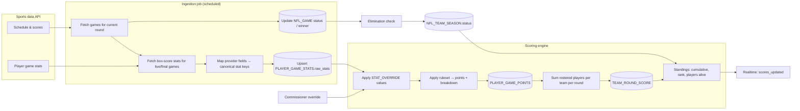
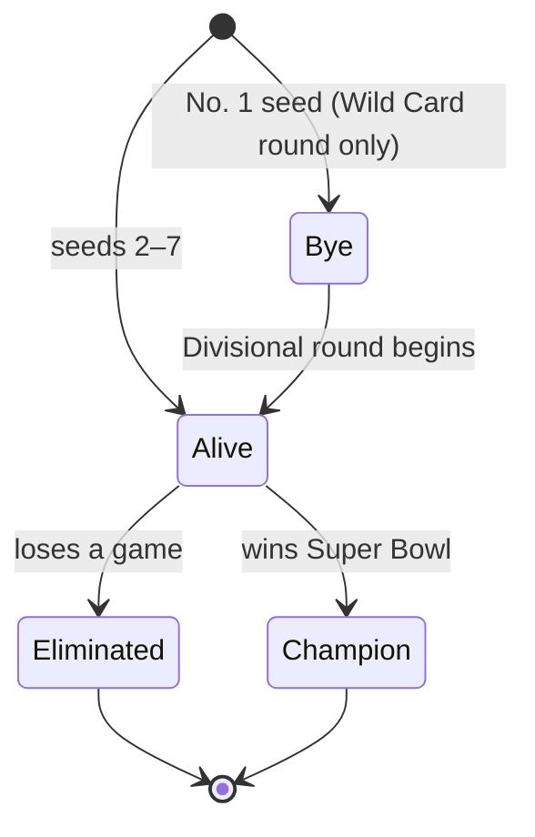
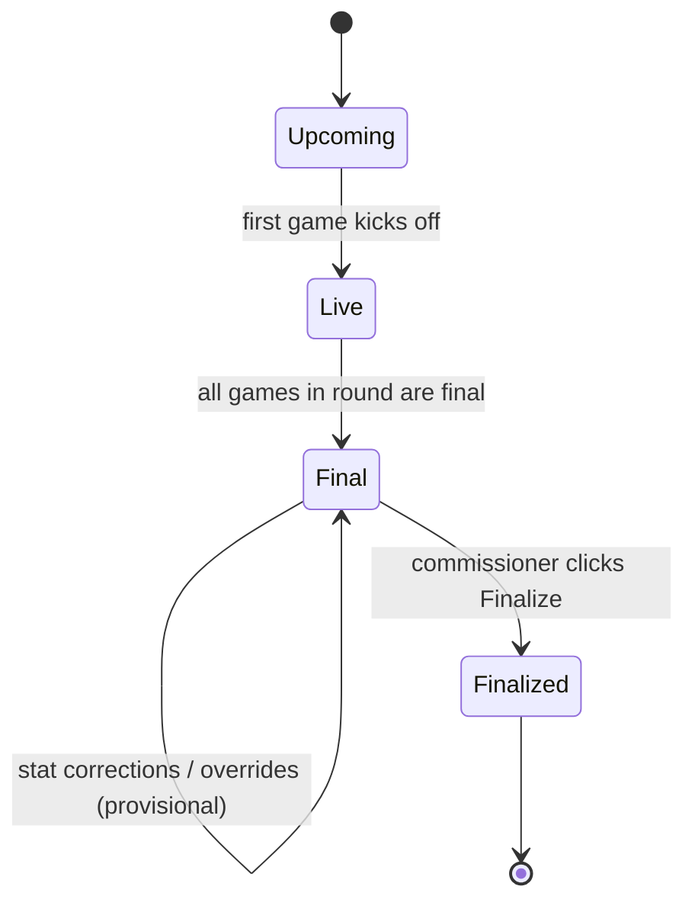

# 04 — Scoring Design

## 1. Principles

1. **Rules are data, not code.** The league's custom scoring lives in a versioned JSON ruleset. Changing a value never needs a deploy.
2. **Derived, never edited.** Points are always computed from `raw provider stats ⊕ commissioner overrides` using the ruleset. Nothing is hand-typed into a points column.
3. **Recompute anytime.** Any change (new stats, override, rules fix) triggers a recompute of the affected player-games and teams. Same inputs → same outputs.
4. **Provisional vs. final.** Live game scores are shown as provisional; the commissioner finalizes each round to freeze it.

## 2. Scoring ruleset (configurable)

The actual values come from the league (see Q1). The engine supports these rule types so the custom rules can be expressed without code:

| Rule type | Example | Shape |
|-----------|---------|-------|
| **Per unit** | 1 pt per 10 rushing yards | `{stat, points, per}` |
| **Per event** | 6 pts per rushing TD, −2 per interception | `{stat, points}` |
| **Threshold bonus** | +3 for 100+ rushing yards in a game | `{stat, gte, points}` |
| **Tiered (bands)** | DST points allowed: 0 → +10, 1–6 → +7 … | `{stat, tiers:[{min,max,points}]}` |
| **Distance bands** | FG 0–39 → 3, 40–49 → 4, 50+ → 5 | tiered on each event's distance |
| **Position scope** | TE-premium reception points | any rule may add `positions:[…]` |

Rulesets live as data in `packages/domain/rulesets/`: `placeholder.v1.json` (the doc's original skeleton, **not** the league's rules) and `league.v1.json` (the league's rules as received 2026-11-10). `pnpm admin seed-ruleset` seeds either as v1 of a season (default `league`). The engine is `packages/domain/src/scoring/` (pure, 100% covered).

### Ruleset JSON

```json
{ "version": 1, "rounding": 2, "rules": [
  { "stat": "rush_yds", "points": 1, "per": 10, "fractional": true },
  { "stat": "rush_td", "points": 6 },
  { "stat": "rush_yds", "gte": 100, "points": 3 },
  { "stat": "fg_made", "tiers": [ {"min":0,"max":39,"points":3}, {"min":40,"max":49,"points":4}, {"min":50,"points":5} ] },
  { "stat": "xp_made", "points": 1, "positions": ["K"] } ] }
```

- A rule's `type` (`per_unit | per_event | bonus | tiers | distance_tiers`) is optional and inferred from its fields; if given it must match. `label` is shown in breakdowns. `positions` scopes any rule (out-of-scope rules contribute nothing).
- **Per unit:** whole units only by default (99 yds at 1 per 10 = 9; a negative stat truncates toward zero, -15 yds = -1). `"fractional": true` opts into `points * value / per` (99 yds = 9.9; -3 yds = -0.3).
- **Bonus:** `gte` pays once when the stat is at or above the threshold.
- **Tiers:** bands `{min, max?, points}` on the stat total. Validation: no overlap, no gap, first band starts at 0, last band open-ended (omit `max`).
- **Distance tiers:** a tiers rule on `fg_made` / `fg_missed` scores each kick by its own distance (the stat line carries the distance list).
- **Arithmetic:** integer micro-points (no float drift), rounded once per game, half away from zero, to `rounding` decimals (0..4, default 2). Breakdown entries are rounded the same way, so they may differ from the total by a rounding step; zero-point rules are omitted.
- **Validation:** unknown stat keys (the message lists valid ones), unknown fields, mixed rule shapes, `fractional` without `per`, and more than 4 decimals are rejected; errors name the rule index and stat.

### Canonical stat keys and stat lines

`pass_yds pass_td pass_int pass_2pt rush_yds rush_td rush_2pt rec rec_yds rec_td rec_2pt fum_lost ret_td fum_rec_td fg_made fg_missed fg_blocked xp_made xp_missed xp_blocked def_pts_allowed def_yds_allowed def_sack def_int def_fum_rec def_td def_safety def_block`

- 2-pt conversions are **split by type** (no generic `two_pt`): the passer gets `pass_2pt` and the receiver `rec_2pt` for the same conversion.
- `ret_td` = kick/punt return TDs (any position, incl. a DST line); `fum_rec_td` = fumble-recovery TDs by non-defense players; `def_td` = defensive TDs (DST).
- Kicker misses: `fg_missed` / `xp_missed`; blocked kicks against the kicker: `fg_blocked` / `xp_blocked`. `def_block` is the defending team's own stat.
- A **stat line** is `{ counts: {key: int}, events?: { fg_made?: number[], fg_missed?: number[] } }`. A distance list's length must equal the count (a missing count is filled from it); a distance rule on a count without distances is an error.
- **Overrides** replace single counts. Lowering `fg_made`/`fg_missed` below its distance list keeps the first N distances; raising it above the list is rejected.
- **Season compute** (`computeSeason`): POINTS per player-game and TEAMSCORE per round+team, non-finalized rounds only. A roster is `{slot, playerId, fromRound}` entries; in round R a slot holds its entry with the greatest `fromRound <= R` (roster exceptions, Task 12). Unscorable player-games come back as `issues`, not exceptions. `computeStandings` adds rank (ties share a rank and are flagged, Q4), players alive, and max games remaining.

### The league's rules (`league.v1.json`)

Received 2026-11-10: QB passing 1 pt per 30 yds; rushing and receiving 1 pt per 10 yds (all **fractional**, rounded once per game to 2 decimals); full-point PPR; every TD 6 (pass, rush, rec, kick/punt return, fumble-recovery, DST defensive/return); 2-pt conversions +2 (passer and receiver each); interception thrown -1, fumble lost -1; no yardage or threshold bonuses. Kicker: XP +1; FG 0-39 yds 3, 40-49 yds 4, 50+ yds 5; -1 per missed or blocked FG or XP. DST points allowed: 0 -> 15, 1-6 -> 10, 7-13 -> 8, 14-20 -> 5, 21-27 -> 2, 28-34 -> 0, 35+ -> -5; 1 pt each per sack, interception, fumble recovery, blocked kick; safety 2; defensive/return TD 6.

**Assumed, pending commissioner confirmation:** points allowed = the opponent's final score (Q13); passing yards by non-QBs score 0.

**Lifecycle:** draft the ruleset → commissioner reviews with a "preview against last year's playoffs" tool → **lock** before the draft. A locked ruleset can only change through a new version, which triggers a full recompute and an audit entry.

**Editing in the app (Commissioner → Scoring; members read it on Rules & scoring):**
- API: `GET /seasons/:id/scoring` (any member: active ruleset + version list, no user ids/emails); commissioner-only `POST …/scoring/seed {ruleset: league|placeholder}` (409 `ruleset_exists` if any version exists), `PUT …/scoring/versions/:v` (unlocked only; 409 `ruleset_locked` otherwise), `POST …/scoring/versions {rules, rounding, note?, activate}` (next version), `POST …/versions/:v/lock`, `POST …/versions/:v/activate`. Each write is audited (`ruleset.create|update|lock|activate`) in the same transaction.
- Validation is the domain parser on both client and server. A bad ruleset is a 400 `validation_error` whose `error.ruleErrors` is `[{ruleIndex, stat, message}]` (`ruleIndex` null for whole-ruleset problems) so the UI can show each message on its row.
- The active version unlocked: "Save changes" edits it in place. Locked: "Save as new version" creates vN+1 and activates it; older versions stay as history and can be made active again.
- The **preview** table scores the golden-fixture players (2025-26 Wild Card, `@dnp/domain` `GOLDEN_PLAYERS`) under the saved rules and under the unsaved edits. It is the stand-in for the "preview against last year's playoffs" tool until real stats are ingested.
- A change to the active ruleset's points (seed, edit of the active version, create+activate, activate) calls the `onRulesetChange` hook (`apps/api/src/scoring/hooks.ts`), a no-op today. TODO (Task 9/10, doc 10 §4.4): it must recompute non-finalized rounds and publish `scores_updated`. Locking changes no points and does not call it.

## 3. Stats pipeline



### Ingestion schedule
| Situation | Frequency |
|-----------|-----------|
| A playoff game is in progress | every 1–2 minutes |
| Game day, no game live | every 15 minutes |
| Between rounds (stat-correction period) | every 6 hours |
| Season complete | off |

Jobs are idempotent: re-running with the same provider data changes nothing.

### Provider adapter interface
```
interface StatsProvider {
  getPlayoffField(seasonYear)  → teams, seeds, conferences
  getPlayers(teamIds)          → players with positions, injury status
  getGames(round)              → schedule, status, scores, winners
  getPlayerGameStats(gameId)   → per-player stat lines (provider fields)
  mapToCanonical(statLine)     → { canonical_key: value }
}
```
A **manual/CSV adapter** implements the same interface as a fallback if the API fails during a game.

## 4. Elimination & player status

When a game goes final, the loser's `NFL_TEAM_SEASON.status` becomes `eliminated` (with the round), the winner stays `alive`, and the Super Bowl winner becomes `champion`.



Each rostered player inherits their NFL team's status. The UI shows per fantasy team:
- **Players alive** (e.g. "6/10 alive")
- **Max games remaining** — sum over alive players of rounds left their team could play. A useful "upside" indicator, especially since #1-seed players play at most 3 games.

## 5. Team scores & standings

```
player_round_points(p, r) = Σ points of p's games in round r   (0 if bye/eliminated)
team_round_points(t, r)   = Σ player_round_points over t's 10 roster slots for round r
team_total(t)             = Σ team_round_points over all rounds
```

- With roster exceptions, a slot may hold different players in different rounds; the transaction's `effective_round` decides which player counts in which round.
- Standings sort by `team_total` desc. Ties → tiebreaker rules (Q4); until decided, tied teams share the rank and the commissioner is alerted.
- Final placings (1st/2nd/3rd) are shown once the Super Bowl round is finalized.

## 6. Round finalization



- **Live/Final**: scores update automatically and are marked provisional.
- **Finalized**: the round's points are frozen. Ingestion keeps raw stats, but late changes no longer move frozen points (the commissioner sees a "provider changed after finalization" warning and can choose to unfreeze — audited).

## 7. Commissioner overrides

- Edit any canonical stat for a player-game (e.g. "rush_td: 1 → 2, reason: stat correction").
- Overrides are stored separately and re-applied after every ingestion, so the provider can't overwrite them.
- The player page shows overridden stats with a marker and the reason.
- Everything is in the audit log.

## 8. Testing strategy for scoring

- **Unit tests** per rule type with hand-computed expectations.
- **Golden test:** run the engine against last season's (2025–26) playoffs with the final ruleset and compare a handful of players against hand calculations.
- **Replay test:** feed recorded provider responses for a past playoff weekend through ingestion to check live → final → elimination transitions end to end.
