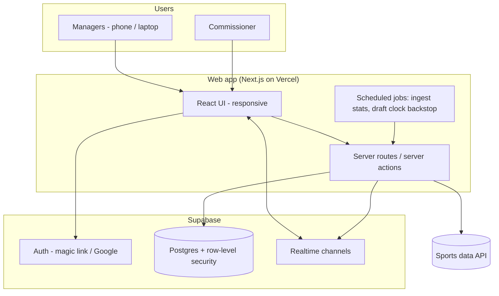
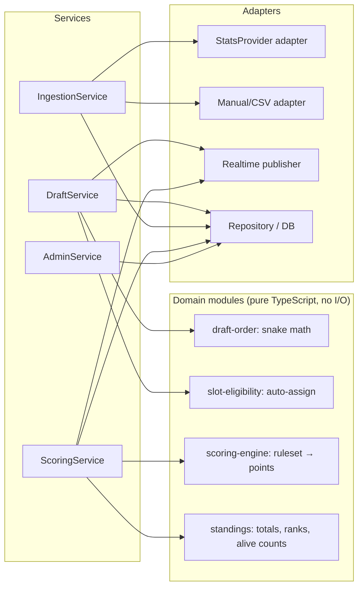

# 05 — Architecture

> **Superseded in part (2026-11-09):** the stack moved to AWS + Terraform. See [09-aws-architecture](09-aws-architecture.md) for hosting, database, auth, realtime, jobs, draft clock and environments. Sections 3 (logical components), 4 (API surface), 7 (security principles; RLS → IAM + server-side checks) and 9 (stats provider spike) still apply.

## 1. System context

## 2. Recommended stack

| Concern | Choice | Why |
|---------|--------|-----|
| Frontend + server | **Next.js (TypeScript)** | One codebase for UI and API; easy for Claude Code to scaffold |
| Hosting | **Vercel** (hobby tier) | Zero-ops deploys, preview URLs for testing |
| Database | **Supabase Postgres** | Relational fits the domain; constraints enforce draft invariants |
| Auth | **Supabase Auth** (email magic link, optional Google) | No passwords for 9 friends |
| Realtime | **Supabase Realtime** broadcast channels | Live draft and live scores without running a socket server |
| Scheduled jobs | Vercel Cron (≥1 min) + Supabase pg_cron | Stats ingestion; draft clock backstop |
| Styling | Tailwind CSS | Fast, mobile-first |
| Testing | Vitest (scoring engine, pick logic), Playwright (draft room E2E) | |

**Alternative considered:** a small Node server (Fastify + Socket.IO) on Fly.io/Render with its own Postgres. More control over the draft clock (in-process timers), but more to operate. Not needed at this scale.

## 3. Logical components

Keeping the rules (snake order, slot eligibility, scoring) as **pure functions** makes them easy to unit test and easy for Claude Code to build first.

## 4. API surface (v1)

| Method & path | Who | Purpose |
|---------------|-----|---------|
| `GET  /api/seasons/:id` | member | Season summary, status |
| `POST /api/seasons` | commissioner | Create season |
| `POST /api/seasons/:id/invites` | commissioner | Generate invite links |
| `PUT  /api/seasons/:id/ruleset` | commissioner | Edit / lock scoring ruleset |
| `POST /api/seasons/:id/player-pool/import` | commissioner | Import playoff field + players |
| `PATCH /api/players/:id` | commissioner | Edit pool (include/exclude, fix position) |
| `GET  /api/drafts/:id` | member | Full draft snapshot |
| `PUT  /api/drafts/:id/settings` | commissioner | Order, clock, start time |
| `POST /api/drafts/:id/start` · `/pause` · `/resume` | commissioner | Lifecycle |
| `POST /api/drafts/:id/picks` | manager on clock / commissioner | Make pick `{player_id, expected_pick}` |
| `POST /api/drafts/:id/undo` | commissioner | Undo last pick |
| `POST /api/drafts/:id/tick` | any member | Ask server to autopick if the deadline passed |
| `GET/PUT /api/teams/:id/queue` | owning manager | Draft queue |
| `GET  /api/seasons/:id/standings` | member | Standings with per-round points |
| `GET  /api/teams/:id` | member | Roster, player statuses, points |
| `GET  /api/players/:id/games` | member | Stat lines + point breakdowns |
| `POST /api/stat-overrides` | commissioner | Override a stat |
| `POST /api/rounds/:id/finalize` | commissioner | Freeze a round |
| `POST /api/roster-transactions` | commissioner | Apply an exception |
| `POST /api/jobs/ingest` | cron (secret) | Run ingestion |
| `GET  /api/seasons/:id/audit` | member | Audit log (read-only) |

## 5. Realtime channels

| Channel | Events |
|---------|--------|
| `draft:{draftId}` | `pick_made`, `pick_undone`, `status_changed`, `presence` |
| `season:{seasonId}` | `scores_updated` (round id + changed team ids), `team_eliminated`, `round_finalized` |

Clients always fall back to a REST snapshot on (re)connect; events are only incremental updates.

## 6. The draft clock (serverless-friendly)

Serverless functions can't hold a timer, so the clock uses a **stored deadline + "tick"** pattern:

1. Each pick sets `current_pick_deadline` in the DB.
2. Every connected client shows a countdown from that deadline. When it hits zero, clients call `POST /drafts/:id/tick`.
3. `tick` locks the draft row and autopicks **only if** the deadline really has passed and the pick hasn't moved. Many clients calling at once is safe — one wins, the rest no-op.
4. A backstop cron/pg_cron job runs `tick` regularly in case nobody is connected.

## 7. Security

- Every API route checks the session and the caller's role in the season.
- Postgres row-level security as a second layer: members can read their season; only server-side code with the service role can write draft picks, stats and scores.
- Ingestion endpoint protected by a cron secret.
- Commissioner actions always write an `AUDIT_EVENT`.
- Stats API key stored only as a server-side environment variable.

## 8. Environments

| Env | Purpose |
|-----|---------|
| Local | Development with Supabase local stack and a mock stats adapter |
| Preview | Per-branch Vercel deploys for review |
| Production | The league's live app |

Seed data: last season's (2025–26) playoff field, players and stats — used for mock drafts and scoring replay tests.

## 9. Stats provider selection (Phase 0 spike)

Pick a provider by testing, not by marketing pages. Candidates to evaluate: a paid NFL data API with a monthly plan (e.g. SportsDataIO, MySportsFeeds) and free public/unofficial feeds (e.g. Sleeper, ESPN). *Verify current availability and pricing during the spike.*

| Criterion | Must have |
|-----------|-----------|
| Postseason coverage | Player box-score stats for playoff games |
| Freshness | Updates during live games (≤ few minutes delay) |
| Stat coverage | Everything the custom ruleset needs (incl. DST and K detail like FG distance) |
| Stat corrections | Reflects official corrections after games |
| Cost | Affordable for ~1 month of use |
| Terms | Allows use in a private app |

The adapter interface (see 04 §3) keeps the choice reversible, and the manual/CSV adapter is the fallback.
