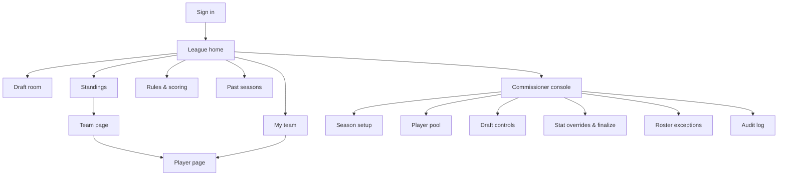

# 06 — UI Screens

Mobile-first. Wireframes are low-fidelity layouts, not visual design.

## 1. Site map



## 2. Screen inventory

| Screen | Primary users | Key content |
|--------|---------------|-------------|
| Sign in | All | Magic-link email field / Google |
| League home | All | Season status banner (setup / draft at… / Round X live), quick links, my rank |
| Draft room | Managers | On-the-clock banner + countdown, available players, my queue, my roster, draft board |
| Standings | All | Rank, team, per-round points, total, players alive, max games left |
| Team page | All | 10 slots with player, NFL team, status chip (Alive/Bye/Out), points per round |
| Player page | All | Game-by-game stat lines, points breakdown, override markers |
| Rules & scoring | All | Human-readable ruleset, roster rules, tiebreakers |
| Past seasons | All | Archived standings and champions |
| Commissioner console | Commissioner | Setup checklist, pool, draft controls, overrides, finalize, exceptions, audit |

## 3. Draft room — phone

```
┌───────────────────────────────┐
│ R3 · Pick 23 of 90            │
│ ON THE CLOCK: Jake's Team 0:47│
│ You pick in 2 (pick 25)       │
├───────────────────────────────┤
│ [Players] [Queue] [Roster] [Board]
├───────────────────────────────┤
│ Search…        Pos: ALL ▾     │
│ Team: ALL ▾    Hide ineligible☑│
├───────────────────────────────┤
│ RB  J. Runner   BUF (2) vs PIT│
│     Proj 14.2   ★ Queue  DRAFT│
│ WR  A. Catcher  KC  (1) BYE   │
│     Proj 11.8   ★ Queue  DRAFT│
│ TE  T. Blocker  PHI (3) Q     │
│     Proj  8.1   ★ Queue  DRAFT│
│ …                             │
├───────────────────────────────┤
│ Last: #22 Mike → QB B. Arm    │
└───────────────────────────────┘
```
- `(2)` = seed; `BYE` = #1 seed sits out Wild Card; `Q` = injury tag.
- DRAFT buttons are enabled only for the manager on the clock and only for eligible players.
- Confirmation sheet before submitting a pick ("Draft J. Runner → RB2?").

## 4. Draft room — desktop

```
┌──────────────────────────────────────────────────────────────────────────────┐
│ Round 3 · Pick 23/90   ON THE CLOCK: Jake's Team   ⏱ 0:47     [Pause] (comm) │
├───────────────────────────────┬──────────────────────────────┬───────────────┤
│ AVAILABLE PLAYERS             │ DRAFT BOARD                  │ MY ROSTER     │
│ Search…  Pos▾ Team▾           │      T1   T2   T3 … T9       │ QB   B. Arm   │
│ RB J. Runner BUF(2)  [Draft]  │ R1  QB.. RB.. WR..  …        │ RB1  —        │
│ WR A. Catcher KC(1)  [Draft]  │ R2  ..   ..   ..    …        │ RB2  —        │
│ …                             │ R3  ..   ..   [23]          │ WR1  C. Hands │
│                               │ …                            │ WR2  —        │
│                               │ R10                          │ TE   —        │
├───────────────────────────────┤                              │ FLEX1 —       │
│ MY QUEUE (drag to reorder)    │                              │ FLEX2 —       │
│ 1. J. Runner                  │                              │ DST  —        │
│ 2. T. Blocker                 │                              │ K    —        │
└───────────────────────────────┴──────────────────────────────┴───────────────┘
```
Board cells are colour-coded by position.

## 5. Standings

```
┌───────────────────────────────────────────────────────────────────┐
│ STANDINGS · Divisional round LIVE (provisional)                   │
├────┬────────────────┬──────┬──────┬──────┬──────┬───────┬────────┤
│ #  │ Team           │  WC  │ DIV  │ CONF │  SB  │ TOTAL │ Alive  │
├────┼────────────────┼──────┼──────┼──────┼──────┼───────┼────────┤
│ 1  │ Jake's Team    │ 98.4 │ 41.2*│  —   │  —   │ 139.6 │ 7/10   │
│ 2  │ Mike's Team    │ 104.1│ 30.0*│  —   │  —   │ 134.1 │ 5/10   │
│ …  │                │      │      │      │      │       │        │
└────┴────────────────┴──────┴──────┴──────┴──────┴───────┴────────┘
 * provisional   🥇🥈🥉 shown after Super Bowl is finalized
```
Tap a row → team page. Optional column: max games left.

## 6. Team page

```
┌───────────────────────────────────────────────┐
│ Jake's Team   #1 · 139.6 pts · 7/10 alive     │
├──────┬──────────────┬──────┬──────┬─────┬─────┤
│ Slot │ Player       │ Team │Status│ WC  │ DIV │
├──────┼──────────────┼──────┼──────┼─────┼─────┤
│ QB   │ B. Arm       │ BUF  │ ●    │ 24.1│ 12.3│
│ RB1  │ J. Runner    │ BUF  │ ●    │ 18.0│  6.2│
│ WR1  │ A. Catcher   │ KC   │ ●    │ BYE │  9.9│
│ TE   │ T. Blocker   │ PHI  │ ✕ OUT│  4.1│  —  │
│ …    │              │      │      │     │     │
└──────┴──────────────┴──────┴──────┴─────┴─────┘
 ● alive  ◐ bye  ✕ eliminated
```

## 7. Commissioner console

```
┌───────────────────────────────────────────────┐
│ SEASON SETUP CHECKLIST                        │
│ ☑ 9 managers joined                           │
│ ☑ Scoring ruleset locked (v1)                 │
│ ☐ Playoff field imported   [Import now]       │
│ ☐ Draft order set          [Randomize] [Edit] │
│ ☐ Draft time & clock       [Edit]             │
├───────────────────────────────────────────────┤
│ ROUNDS                                        │
│ WC   Final · 3 overrides     [Finalize]       │
│ DIV  Live                                     │
├───────────────────────────────────────────────┤
│ [Stat overrides] [Roster exceptions] [Audit]  │
└───────────────────────────────────────────────┘
```
