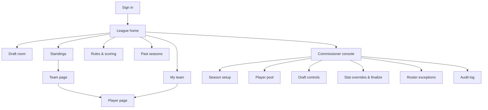

# 06 — UI Screens

Mobile-first. Wireframes are low-fidelity layouts, not visual design.

## 1. Site map



## 2. Screen inventory

| Screen | Primary users | Key content |
|--------|---------------|-------------|
| Sign in | All | Magic-link email field / Google |
| League home | All | Season status banner (setup / draft at… / Round X live), quick links, my rank |
| Draft room | Managers | On-the-clock banner + countdown, available players, my queue, my roster, draft board |
| Standings | All | Rank, team, per-round points, total, players alive, max games left |
| Team page | All | 10 slots with player, NFL team, status chip (Alive/Bye/Out), points per round |
| Player page | All | Game-by-game stat lines, points breakdown, override markers |
| Rules & scoring | All | Human-readable ruleset, roster rules, tiebreakers |
| Past seasons | All | Archived standings and champions |
| Commissioner console | Commissioner | Setup checklist, pool, draft controls, overrides, finalize, exceptions, audit |

## 3. Draft room — phone

```
┌───────────────────────────────┐
│ R3 · Pick 23 of 90            │
│ ON THE CLOCK: Jake's Team 0:47│
│ You pick in 2 (pick 25)       │
├───────────────────────────────┤
│ [Players] [Queue] [Roster] [Board]
├───────────────────────────────┤
│ Search…        Pos: ALL ▾     │
│ Team: ALL ▾    Hide ineligible☑│
├───────────────────────────────┤
│ RB  J. Runner   BUF (2) vs PIT│
│     Proj 14.2   ★ Queue  DRAFT│
│ WR  A. Catcher  KC  (1) BYE   │
│     Proj 11.8   ★ Queue  DRAFT│
│ TE  T. Blocker  PHI (3) Q     │
│     Proj  8.1   ★ Queue  DRAFT│
│ …                             │
├───────────────────────────────┤
│ Last: #22 Mike → QB B. Arm    │
└───────────────────────────────┘
```
- `(2)` = seed; `BYE` = #1 seed sits out Wild Card; `Q` = injury tag.
- DRAFT buttons are enabled only for the manager on the clock and only for eligible players.
- Confirmation sheet before submitting a pick ("Draft J. Runner → RB2?").

## 4. Draft room — desktop

```
┌──────────────────────────────────────────────────────────────────────────────┐
│ Round 3 · Pick 23/90   ON THE CLOCK: Jake's Team   ⏱ 0:47     [Pause] (comm) │
├───────────────────────────────┬──────────────────────────────┬───────────────┤
│ AVAILABLE PLAYERS             │ DRAFT BOARD                  │ MY ROSTER     │
│ Search…  Pos▾ Team▾           │      T1   T2   T3 … T9       │ QB   B. Arm   │
│ RB J. Runner BUF(2)  [Draft]  │ R1  QB.. RB.. WR..  …        │ RB1  —        │
│ WR A. Catcher KC(1)  [Draft]  │ R2  ..   ..   ..    …        │ RB2  —        │
│ …                             │ R3  ..   ..   [23]          │ WR1  C. Hands │
│                               │ …                            │ WR2  —        │
│                               │ R10                          │ TE   —        │
├───────────────────────────────┤                              │ FLEX1 —       │
│ MY QUEUE (drag to reorder)    │                              │ FLEX2 —       │
│ 1. J. Runner                  │                              │ DST  —        │
│ 2. T. Blocker                 │                              │ K    —        │
└───────────────────────────────┴──────────────────────────────┴───────────────┘
```
Board cells are colour-coded by position.

## 5. Standings

```
┌───────────────────────────────────────────────────────────────────┐
│ STANDINGS · Divisional round LIVE (provisional)                   │
├────┬────────────────┬──────┬──────┬──────┬──────┬───────┬────────┤
│ #  │ Team           │  WC  │ DIV  │ CONF │  SB  │ TOTAL │ Alive  │
├────┼────────────────┼──────┼──────┼──────┼──────┼───────┼────────┤
│ 1  │ Jake's Team    │ 98.4 │ 41.2*│  —   │  —   │ 139.6 │ 7/10   │
│ 2  │ Mike's Team    │ 104.1│ 30.0*│  —   │  —   │ 134.1 │ 5/10   │
│ …  │                │      │      │      │      │       │        │
└────┴────────────────┴──────┴──────┴──────┴──────┴───────┴────────┘
 * provisional   🥇🥈🥉 shown after Super Bowl is finalized
```
Tap a row → team page. Optional column: max games left.

**Built (Task 10), `/standings`:** the header reads "Standings · <latest started round> <status>" (e.g. "Standings · Divisional Live"). Columns # / Team / WC / DIV / CONF / SB / Total / Alive (`7/10`); a provisional round value carries `*` with a footnote, a round without a score shows "—", tied teams show "T-2", and the medals appear only once the API returns `placings` (Super Bowl finalized). At 375 px the round columns are hidden and each team's rounds appear under its name (the table scrolls inside its own box, never the page). Rows are not links yet: the team page is Task 11. The page refetches on `scores_updated` from the season's realtime channel (members may subscribe) and, only while a round is live and the socket is down, every 60 seconds.

## 6. Team page

```
┌───────────────────────────────────────────────┐
│ Jake's Team   #1 · 139.6 pts · 7/10 alive     │
├──────┬──────────────┬──────┬──────┬─────┬─────┤
│ Slot │ Player       │ Team │Status│ WC  │ DIV │
├──────┼──────────────┼──────┼──────┼─────┼─────┤
│ QB   │ B. Arm       │ BUF  │ ●    │ 24.1│ 12.3│
│ RB1  │ J. Runner    │ BUF  │ ●    │ 18.0│  6.2│
│ WR1  │ A. Catcher   │ KC   │ ●    │ BYE │  9.9│
│ TE   │ T. Blocker   │ PHI  │ ✕ OUT│  4.1│  —  │
│ …    │              │      │      │     │     │
└──────┴──────────────┴──────┴──────┴─────┴─────┘
 ● alive  ◐ bye  ✕ eliminated
```

## 6a. Rules & scoring (members) and the Scoring section (commissioner)

- **Rules & scoring** (`/rules`, all members, read-only): the active ruleset in plain sentences grouped Passing, Rushing, Receiving, Touchdowns & 2-pt, Turnovers, Kicking, Defense (DST), Bonuses (e.g. "Rushing yards: 1 pt per 10 yds (fractional)"), with the DST points-allowed table and the field-goal distance table, the version and a Locked badge. No ruleset yet: "Scoring rules haven't been set yet."
- **Commissioner → Scoring**: with no ruleset, "Load league rules" (and a smaller "Load placeholder rules"). Otherwise a grouped form (points; per + fractional with a live example; bonus threshold; editable bands; position checkboxes; add/remove rule; rounding), an "Advanced: edit JSON" box kept in sync and validated on blur, inline per-rule errors, a **Preview** (golden players, saved vs edited), Save changes (unlocked) or Save as new version (locked) with an optional note, Discard, an unsaved-changes indicator with a leave warning, Lock rules (confirm), and a version history with "Make active" (confirm). Details of the API and lifecycle are in [04](04-scoring-design.md) §2.

## 7. Commissioner console

```
┌───────────────────────────────────────────────┐
│ SEASON SETUP CHECKLIST                        │
│ ☑ 9 managers joined                           │
│ ☑ Scoring ruleset locked (v1)                 │
│ ☐ Playoff field imported   [Import now]       │
│ ☐ Draft order set          [Randomize] [Edit] │
│ ☐ Draft time & clock       [Edit]             │
├───────────────────────────────────────────────┤
│ ROUNDS                                        │
│ WC   Final · 3 overrides     [Finalize]       │
│ DIV  Live                                     │
├───────────────────────────────────────────────┤
│ [Stat overrides] [Roster exceptions] [Audit]  │
└───────────────────────────────────────────────┘
```

**Built (Task 10).** The **Rounds** card sits above Live stats: one row per round with its code and name, a status badge (Upcoming / Live / Final / Finalized), the number of overrides, and
- **Finalize** (round is Final), after a confirmation "Freeze Wild Card points? Late stat changes won't move them until you unfreeze.";
- "Finalized <date>" and **Unfreeze** (round is Finalized), which asks for a required reason;
- a warning "ESPN changed stats after you finalized this round" when `providerChangedAt` is set.

The card links to **Stat overrides** (`/commissioner/overrides`, commissioner only): pick a round, then a game (`AWY 24 @ HOME 31 · Final`), then see the game's lines (player, position, points, an "Edited" marker). **Edit** opens every canonical key relevant to the position (QB/RB/WR/TE: passing, rushing, receiving, 2-pt, fumble and return keys; K: kicking keys; DST: defensive keys and `ret_td`), each showing ESPN's value, the current override, a number input and Save; one required reason applies to the save; an existing override shows its reason and **Clear**. A finalized round is read-only with a note to unfreeze it first. The Rounds and Live stats cards share one copy of `GET /seasons/:id/ingest`, which also carries per-round `overrideCount`, `finalizedAt` and `providerChangedAt`.
