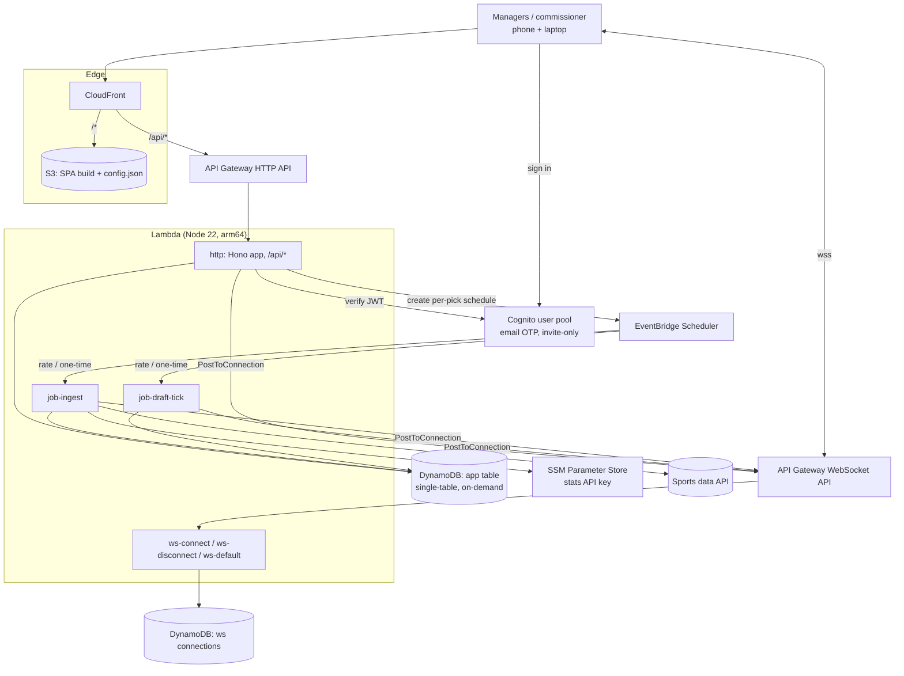
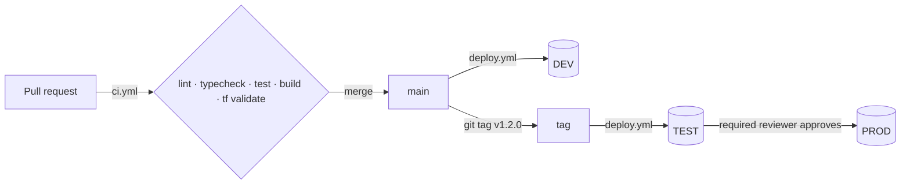

# 09 — AWS Architecture (supersedes 05 §1–2, §5–6, §8)

Decided 2026-11-09: all resources on **AWS**, provisioned with **Terraform**. This replaces the Vercel + Supabase stack in [05-architecture](05-architecture.md). Everything else in 05 (logical components, API surface, security principles, provider selection) still applies.

**Database: DynamoDB** (single-table), also decided 2026-11-09 after comparing Aurora Serverless v2, Neon and Supabase. The data model is in [10-dynamodb-data-model](10-dynamodb-data-model.md).

## 1. System diagram



There's no VPC, no NAT, no database server, and nothing billed by the hour.

## 2. Component choices

| Concern | Choice | Notes |
|---|---|---|
| Frontend | **React + Vite + TypeScript + Tailwind v4**, React Router | Static SPA in S3 behind CloudFront (OAC). Runtime config from `/config.json` so one build serves every env. |
| API | **Hono** on a single Lambda (`http`) behind an HTTP API `$default` route | Base path `/api`. CloudFront routes `/api/*` to it, so the browser talks to one origin and there's no CORS. |
| Auth | **Cognito** user pool, Essentials tier, passwordless **email OTP**, admin-create-only (invite-only) | JWT verified in Hono middleware with `aws-jwt-verify` (not an API Gateway authorizer, so `/api/health` stays public). |
| Database | **DynamoDB** single table `dnp-<env>-app` (pk/sk + `gsi1`), on-demand, PITR in prod | Accessed with `@aws-sdk/lib-dynamodb` through repositories in `@dnp/db`. Invariants are enforced with conditional writes and transactions. See doc 10. |
| Realtime | **API Gateway WebSocket API** + a separate DynamoDB connection table | Clients send `{action:"subscribe", channel}`; server broadcasts with `PostToConnection`. Channels per 05 §5. |
| Scheduled jobs | **EventBridge Scheduler** | `ingest` (rate, disabled by default) and `draft-tick-backstop` (rate(1 minute), disabled by default). The API also creates a **one-time schedule at each pick deadline** that invokes `job-draft-tick`. |
| Secrets | Stats API key in SSM SecureString | No database credentials: Lambdas use IAM. |
| Schema changes | None (schema in code, zod-validated items) | One-off backfill scripts if an item shape changes. |
| Local dev | **DynamoDB Local** (Java) on :8000 + `@hono/node-server` on :3001 + Vite on :5173 (proxies `/api`) | `pnpm ddb:local`. Realtime and Cognito are stubbed locally. Tests start their own in-memory DynamoDB Local. |
| IaC | Terraform ≥ 1.10, AWS provider `~> 6.0`, S3 backend with `use_lockfile = true` | |
| CI | GitHub Actions: lint, typecheck, test (with DynamoDB Local, Java 21), build; `terraform fmt -check` + `validate` | Deploy job added later (needs an OIDC role). |

### Draft clock on AWS (replaces 05 §6)
Same stored-deadline + idempotent `tick` design. Three triggers, any of which may fire, and all are safe to fire together:
1. Clients call `POST /api/drafts/:id/tick` when their countdown reaches zero.
2. On each pick, the API creates a one-time EventBridge schedule `at(deadline)` that invokes `job-draft-tick` with `{seasonId, expectedPick}`. Delete it after use (`ActionAfterCompletion: DELETE`).
3. A `rate(1 minute)` backstop schedule, enabled only during the draft.

All three funnel into the same pick transaction (doc 10 §4.1), whose `currentPick` condition makes duplicate ticks harmless.

## 3. Repository layout

```
.
├── apps/
│   ├── api/                 @dnp/api   Lambda handlers + Hono app + local server
│   └── web/                 @dnp/web   React SPA
├── packages/
│   ├── domain/              @dnp/domain  pure TS rules (no I/O)
│   └── db/                  @dnp/db      DynamoDB table definition, keys, item schemas, repositories
├── infra/terraform/
│   ├── bootstrap/           state bucket (local state, run once per account)
│   ├── modules/             auth, data, api, realtime, web, jobs, lambda_function, app
│   └── envs/{dev,test,prod}/ root modules
├── scripts/deploy.sh        build → terraform apply → s3 sync → invalidate
├── docs/design/             these docs
└── .github/workflows/     ci.yml (checks), deploy.yml (dev/test/prod pipeline)
```

pnpm workspaces; package scope `@dnp/*`; Node ≥ 22 (`.nvmrc` = 22).

## 4. Build / deploy contract (shared by app code and Terraform)

### Lambda artifacts
`pnpm --filter @dnp/api build` produces one directory per handler, each with a single ESM bundle:

```
apps/api/dist/<handler>/index.mjs     # export const handler
```

Handlers: `http`, `ws-connect`, `ws-disconnect`, `ws-default`, `job-ingest`, `job-draft-tick`.
Lambda config: `runtime = nodejs22.x`, `architectures = ["arm64"]`, `handler = "index.handler"`. Bundles target node22, exclude `@aws-sdk/*` (provided by the runtime), and include a `createRequire` banner for CJS deps.

Terraform zips each directory with `archive_file` from `var.lambda_dist_dir` (default `${path.root}/../../../../apps/api/dist`).

### Lambda environment variables
| Var | Used by | Value |
|---|---|---|
| `APP_ENV` | all | `dev` \| `prod` (`local` when run locally) |
| `APP_TABLE` | http, job-* | app table name |
| `DYNAMODB_ENDPOINT` | local only | e.g. `http://localhost:8000`; unset in AWS |
| `COGNITO_USER_POOL_ID`, `COGNITO_CLIENT_ID` | http | from auth module; if unset, auth middleware is disabled (local) |
| `WS_CONNECTIONS_TABLE` | ws-*, http, job-* | connection table name |
| `WS_MANAGEMENT_ENDPOINT` | http, job-* | `https://{ws-api-id}.execute-api.{region}.amazonaws.com/{stage}` |
| `SCHEDULER_GROUP`, `SCHEDULER_ROLE_ARN`, `DRAFT_TICK_FUNCTION_ARN` | http | for per-pick one-time schedules |
| `STATS_API_KEY_PARAM` | job-ingest | SSM parameter name |

`AWS_REGION` is set by the Lambda runtime; locally it defaults to `us-east-1`.

### App table definition (Terraform and `packages/db/src/table.ts` must match)
- `pk` (S, hash), `sk` (S, range)
- GSI `gsi1`: `gsi1pk` (S, hash), `gsi1sk` (S, range), projection ALL
- TTL attribute `expiresAt` (used by invites)
- `PAY_PER_REQUEST`; PITR and deletion protection in prod only

### Web runtime config
The SPA fetches `/config.json` at startup:
```json
{ "apiBaseUrl": "/api", "wsUrl": "wss://…", "cognitoUserPoolId": "…", "cognitoClientId": "…", "region": "us-east-1", "env": "dev" }
```
Locally it's served from `apps/web/public/config.json` (committed, local values). In AWS, Terraform writes `config.json` to the bucket; `deploy.sh` syncs `apps/web/dist` with `--exclude config.json`.

### DynamoDB connection table
`pk` (S), `sk` (S), TTL attribute `expiresAt`, on-demand billing.
- Connection record: `pk = "conn#<connectionId>"`, `sk = "meta"`, plus `userId`.
- Subscription: `pk = "chan#<channel>"`, `sk = "conn#<connectionId>"`, and a mirror `pk = "conn#<id>"`, `sk = "chan#<channel>"` so disconnect can clean up.

## 5. Terraform conventions
- Name prefix `dnp-${var.env}`; provider `default_tags` = `{ Project = "draft-and-pray", Environment = var.env, ManagedBy = "terraform" }`.
- Region variable, default `us-east-1` (CloudFront ACM certs, if a custom domain is added later, must be in us-east-1 anyway).
- Backend: `backend "s3" {}` with partial config from `backend.hcl` (`backend.hcl.example` committed). CI uses `terraform init -backend=false`.
- `.terraform.lock.hcl` is committed; `.terraform/`, `*.tfstate*`, `backend.hcl` and `*.tfvars` (except `*.tfvars.example`) are gitignored.
- Log groups are created explicitly (14-day retention dev, 90 prod).
- Least-privilege IAM per function: DynamoDB item and query actions scoped to the app table and its indexes (no Scan, no table-level admin).
- An AWS Budgets alert (monthly cost, email) is recommended.

## 6. Cost sketch (hobby scale)
Effectively **$0–1/month** all year. DynamoDB on-demand, Lambda, API Gateway, CloudFront, Cognito (≤ 10,000 MAU) and EventBridge Scheduler all stay at pennies or inside permanent free allowances at ~10 users. The only fixed item is CloudWatch Logs (pennies). There's no idle database charge. *Verify current pricing before relying on these numbers.*

## 7. Things to verify at first `terraform apply`
- Cognito email OTP may require SES as the sender (not `COGNITO_DEFAULT`). The auth module takes an optional `ses_from_email` / SES identity ARN.

## 8. Environments & deployment pipeline

Decided 2026-11-09: three environments in **one AWS account**, isolated by name prefix (`dnp-dev-*`, `dnp-test-*`, `dnp-prod-*`), a separate Terraform state key, and a separate GitHub Environment + deploy role each.

| Env | Purpose | Stability | Deployed by | `is_prod` |
|---|---|---|---|---|
| **dev** | Integration of everything merged to `main` | May break | Every push to `main` (after CI passes) | false |
| **test** | Release candidate the league can try (mock draft) | Stable | Pushing a version tag `vX.Y.Z` | false |
| **prod** | The live league | Stable | Same tag, after a manual approval in GitHub | true |

### Promotion flow



- **Build once, promote the artifact.** In a tag run, one `build` job produces `apps/api/dist` + `apps/web/dist` and uploads them as a workflow artifact. Both the `test` and `prod` jobs deploy **that same artifact**, so PROD runs exactly what was tested.
- **The prod gate** is the GitHub Environment `prod` with a required reviewer (the repo owner). The prod job waits after TEST succeeds until it's approved. Required reviewers on the free plan need the repo to be public; for a private repo this needs GitHub Pro/Team, or the gate must change.
- **Redeploy / rollback:** `workflow_dispatch` with input `environment` (dev|test|prod); the source is the ref chosen in "Use workflow from" (environment policies are evaluated against it): `main` for dev, a `v*` tag for test/prod. Rolling back PROD = dispatch from the previous tag (`gh workflow run deploy.yml --ref v0.1.0 -f environment=prod`); it still goes through the prod approval.
- **Concurrency:** one deploy per environment at a time (`concurrency: deploy-<env>`, no cancel-in-progress).

### AWS authentication (no long-lived keys)
- GitHub OIDC provider (`token.actions.githubusercontent.com`) created once in `infra/terraform/bootstrap`.
- One IAM role per env, `dnp-github-deploy-<env>`. Its trust policy requires `aud = sts.amazonaws.com` **and** `sub = repo:<owner>/<repo>:environment:<env>`, so only jobs running in that GitHub Environment can assume it.
- GitHub Environment deployment policies: `dev` allows branch `main` only; `test` and `prod` allow tags `v*` only. Fork PRs never get these credentials.
- Role permissions: v1 attaches `AdministratorAccess` (Terraform creates IAM roles, Lambda, Cognito, CloudFront…). This is acceptable for a one-person hobby account because the trust policy and environment rules are the real boundary; a scoped policy is a later hardening task. State bucket access is included.

### Configuration (no secrets in the repo)
GitHub **repository variables:** `AWS_REGION`, `TF_STATE_BUCKET`.
GitHub **environment variables** (per env): `AWS_DEPLOY_ROLE_ARN`.
CI writes `backend.hcl` at runtime (`bucket`, `key = draft-and-pray/<env>.tfstate`, `region`, `use_lockfile = true`, `encrypt = true`). Optional per-env Terraform inputs (e.g. `ses_from_email`, `ingest_enabled`) come from `envs/<env>/terraform.tfvars`, which is **committed** for non-secret values. Secrets (stats API key) stay in SSM and are set by hand.

### Bootstrap order (one time, by a human with admin credentials)
1. `terraform -chdir=infra/terraform/bootstrap apply`: state bucket + OIDC provider + 3 deploy roles.
2. `scripts/setup-github.sh`: creates the GitHub Environments and their deployment policies, adds the prod reviewer, and sets the variables from bootstrap outputs (uses `gh`).
3. Push to `main` → DEV deploys. Tag `v0.1.0` → TEST deploys → approve → PROD deploys.
