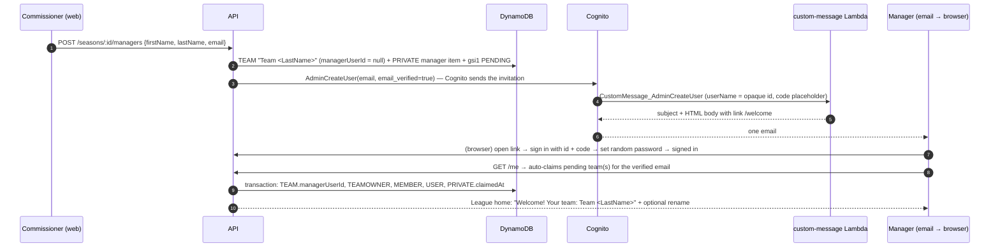

# 13 — One-Step Manager Onboarding (supersedes the invite-link flow in 11)

Decided 2026-11-09 by the owner. Managers must not go through separate "sign up", "verify email" and "join via invite link" steps. Onboarding is **one email, one click**.

Everything in [11](11-auth-and-league-setup.md) about Cognito email-OTP sign-in for *returning* users, the local dev sign-in, test users and the commissioner bootstrap still applies. **§2 (invite items), §4's invite routes and §5's `/join` screen are replaced by this doc** and must be removed.

## 1. Flow

1. **Commissioner adds a manager** (Commissioner page → "Managers" → first name, last name, email). The API creates the team immediately with the default name **`Team <LastName>`** (made unique within the season by appending ` 2`, ` 3`… if needed). Limit: 9 teams per season, and the season must be in `setup`.
2. **Account + email.**
   - **New email:** `AdminCreateUser` with `email` + `email_verified=true`, `DesiredDeliveryMediums=[EMAIL]`. Cognito generates a temporary password and sends the invitation email, which our **CustomMessage Lambda** rewrites (§3). Clicking a link sent to the address proves ownership, so no separate verification step exists.
   - **Email already has a Cognito user** (e.g. the commissioner adding themselves, or a returning manager from last season): no email is sent. The team is assigned the next time they sign in (auto-claim, step 4). The UI tells the commissioner so.
3. **Manager clicks the link** `https://<site>/welcome#u=<cognito-username>&c=<temporary-code>`.
   - The link uses a URL **fragment** (`#`), so the id and code are never sent to CloudFront/API logs. `<cognito-username>` is Cognito's opaque UUID username, **not the email**. No PII in the URL.
   - The welcome page signs in with `USER_AUTH` + `PASSWORD` (username + code) → Cognito responds `NEW_PASSWORD_REQUIRED` → the page sets a **random 32-char password** it immediately forgets (`confirmSignIn`) → the user is signed in. It then clears the fragment from the address bar.
   - Fallback when the link is mangled: `/welcome` also has a form "email + code from the email" doing the same.
   - Expired code (default 7 days) or an already-used link → friendly message: "This link has expired. Ask your commissioner to resend it." (If already set up, it offers normal sign-in instead.)
4. **Auto-claim on `/me`.** Every `GET /me` checks for **pending manager assignments** for the caller's verified email (`gsi1pk = PENDING#<normalized email>`). For each one it runs a transaction:
   - set `TEAM.managerUserId` (condition `attribute_not_exists(managerUserId) OR managerUserId = :null`);
   - put `TEAMOWNER#<userId>` (condition not exists);
   - put `MEMBER` (role `manager`) if absent;
   - put `USER` if absent (`displayName = firstName`);
   - update the private manager item (`claimedAt`, remove `gsi1pk/gsi1sk`);
   - `AUDIT` (`manager_claimed`, ids only).

   `/me` returns `justClaimed: [{seasonId, teamId, teamName}]` so the UI can greet them.
5. **League home after the first claim**: "Welcome to {league} {year}! Your team is **Team Smith**" + an inline optional rename (existing `PATCH /teams/:seasonId/:teamId`) + "Looks good" to dismiss.
6. **Later sign-ins**: unchanged email OTP (`/signin`).

## 2. Commissioner tools
- **Managers table** (commissioner only): team name, manager full name, email, status `invited` / `joined` / `expired` (Cognito user status + `claimedAt`), actions:
  - **Resend** (`AdminCreateUser` with `MessageAction=RESEND`, new temporary code; only while not joined);
  - **Edit** name/email (only while not joined; an email change deletes and recreates the pending Cognito user if it was never confirmed);
  - **Remove** (only while not joined; deletes the team, the private item and, if the Cognito user is still `FORCE_CHANGE_PASSWORD`, that user).
- The commissioner can add **themselves** as a manager (auto-claimed immediately because they already exist).
- Bulk add: paste up to 9 lines of `First,Last,email` → preview → add. Optional, nice to have.

## 3. CustomMessage Lambda (`cognito-custom-message`)
- New Lambda handler `cognito-custom-message`, wired as the user pool's `custom_message` trigger (Terraform `lambda_config`, plus `aws_lambda_permission` for `cognito-idp.amazonaws.com`).
- Handles only `CustomMessage_AdminCreateUser`. Other trigger sources return the event unchanged.
- Builds `emailSubject` = "You're in: {league} {year} on Draft & Pray" and an `emailMessage` (simple inline-styled HTML) containing:
  - the button link `{SITE_URL}/welcome#u={userName}&c={####}`. Cognito requires the literal `{####}` code placeholder, and `{username}` must also appear in the message; we put `{username}` in a small "account id" line;
  - the fallback code;
  - the league/season name and the team name.

  League/team names come from `clientMetadata` passed on `AdminCreateUser`/`RESEND`. **No PII beyond the recipient's own team name**; never other people's names.
- `SITE_URL` comes from a Lambda env var set by Terraform from the web module's CloudFront domain. This edge is cycle-free because the web module doesn't depend on auth.
- Message size must stay under Cognito's 20,000-character limit.
- Cognito's default sender (`COGNITO_DEFAULT`, about 50 emails/day) is fine for 9 managers. SES stays optional.

## 4. Data model (amends doc 10)

| Entity | Keys | Fields | Visible to |
|---|---|---|---|
| Team | `SEASON#<id>` / `TEAM#<teamId>` | `name`, `managerUserId` (**null until claimed**), `draftPosition` | all members |
| Manager private | `SEASON#<id>` / `PRIVATE#MANAGER#<teamId>`; while unclaimed also `gsi1pk = PENDING#<normalized email>`, `gsi1sk = SEASON#<id>` | `firstName`, `lastName`, `email`, `cognitoUsername`, `invitedAt`, `lastSentAt`, `claimedAt?` | **commissioner only** (and never in logs) |
| User | `USER#<userId>` / `PROFILE` | `displayName` = first name, `email` | self; commissioner |

- **Remove** the `INVITE#` items, `SEASONINV#` GSI pattern (A12) and all invite repos/routes/screens from task 3.
- New access pattern **A13**: pending assignments for an email → `Query gsi1 gsi1pk = PENDING#<email>`.
- `loadSeason` and every member-facing response must exclude `PRIVATE#…` items.

## 5. API (replaces doc 11 §4 invite routes)

| Method & path | Auth | Purpose |
|---|---|---|
| `GET /me` | user | As before, plus auto-claim (§1.4) and `justClaimed`. |
| `GET /seasons/:seasonId` | member | Teams **without any PII**: `{teamId, name, isMine}`. `managerDisplayName` is removed; commissioners get names from the managers route. |
| `GET /seasons/:seasonId/managers` | commissioner | `[{teamId, teamName, firstName, lastName, email, status, invitedAt, lastSentAt, claimedAt}]` |
| `POST /seasons/:seasonId/managers` | commissioner | `{firstName, lastName, email}` → creates team + private item + Cognito invite. 409 `season_full`, `season_not_setup`, `email_already_added` (same email already in this season). Returns the row + `emailSent: boolean`. |
| `POST /seasons/:seasonId/managers/:teamId/resend` | commissioner | Resend while not joined. |
| `PATCH /seasons/:seasonId/managers/:teamId` | commissioner | Edit name/email while not joined. |
| `DELETE /seasons/:seasonId/managers/:teamId` | commissioner | Remove while not joined. |
| `PATCH /teams/:seasonId/:teamId` | owner or commissioner | Rename (unchanged). |

Audit events record ids and actions only (`manager_added`, `manager_resent`, `manager_removed`, `manager_claimed`, `team_renamed`): **no names or emails in audit `details`**.

## 6. PII rules (apply to all future work)
1. Names and emails live only in `PRIVATE#…` items and `USER`. They're returned only by commissioner routes and to the user themself.
2. Member-facing views show **team names only**.
3. No PII in URLs, query strings, logs (no logging of request bodies on these routes; redact `email`, `firstName`, `lastName` in any structured log), audit details, error messages, analytics, the repo, docs, commits or test fixtures. Tests use `@example.com` / `@local.test`.
4. The invitation email contains only the recipient's own league, season and team name.
5. Real manager data is entered by the commissioner in the app (prod), never pasted into code or this repo.

## 7. Testing
- **Unit:** CustomMessage handler (placeholders present, link format with fragment, no email in the body, size limit); default team naming and uniqueness; auto-claim transaction (happy path, two seasons, already-claimed race, removed-before-claim); PII filter (member routes never contain `email`/`firstName`/`lastName` keys).
- **Web:** welcome page states (good link → signed in + greeting; expired; malformed; already set up); commissioner managers table add/resend/edit/remove; League home welcome + rename.
- **Local e2e (Playwright):** commissioner adds a manager → (local mode has no Cognito: a dev-only "simulate invite link" that dev-signs-in as that email) → `/me` auto-claims → League home shows "Team <LastName>".
- **DEV smoke:** the script creates fresh `dnp-new-<run>@example.com` managers through the API with a **test-only** query flag that makes the API pass `MessageAction=SUPPRESS` and a known temporary password stored nowhere but the script's memory (accepted only when `APP_ENV != prod` **and** the caller is in the `test-users` group). The script then runs the real `USER_AUTH`/`NEW_PASSWORD_REQUIRED` flow and `/me` auto-claim. No emails are sent to `example.com`.
- **Owner check:** the owner adds a manager with an email they control (e.g. a Gmail `+alias`) on DEV and clicks the real email.
